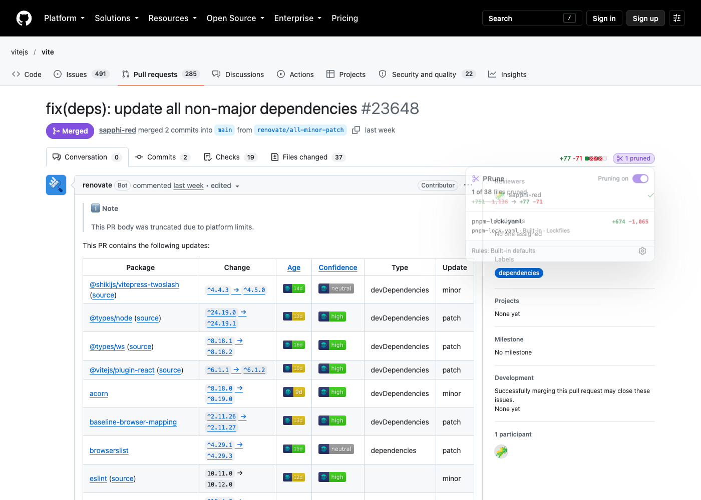
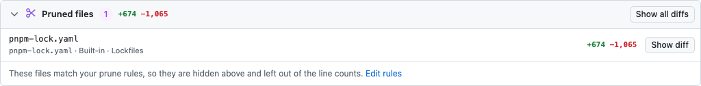

# PRune

**Prune the noise out of GitHub pull requests.** PRune is a browser extension (Firefox/Zen first, Chromium too) that takes lockfiles, snapshots, build output and other generated files out of a PR's line counts and diff, so the numbers you see reflect the code someone actually wrote.

- **Honest line counts.** The `+added −removed` stat and the "Files changed" counter in the PR header leave out pruned files.
- **Pruned diffs move to the bottom.** On the Files changed tab, pruned files are hidden from the diff list and file tree and collected in a **Pruned files** section at the end. You can show any of them again in place.
- **Hover to inspect, one click to toggle.** A small ✂ pill next to the line counts lists what was pruned and why, with an on/off switch for the current PR.
- **Configurable in layers.** Built-in defaults → the repo's `.pruneignore` → your own rules file (by URL) → your personal rules. Everything uses `.gitignore` syntax.





## Install

```sh
bun install
bun run build          # → dist/firefox and dist/chrome
```

### Firefox / Zen

1. Open `about:debugging#/runtime/this-firefox`.
2. Click **Load Temporary Add-on…** and pick `dist/firefox/manifest.json`.

Temporary add-ons are removed when the browser restarts. To keep it installed:

- **Sign it for yourself (free, recommended):** create AMO API keys at <https://addons.mozilla.org/developers/addon/api/key/>, then run `bunx web-ext sign --channel=unlisted --source-dir dist/firefox --api-key=… --api-secret=…`. Install the resulting `.xpi` by opening it in the browser. Unlisted add-ons are not published on the store.
- **Or, if your build allows unsigned add-ons** (Developer Edition, Nightly, and builds that honor `xpinstall.signatures.required = false` in `about:config`), run `bun run package` and install `dist/prune-firefox-<version>.zip`.

Requires Firefox 140 or newer (current Zen is fine).

### Chrome / Edge / Brave / Arc

1. Open `chrome://extensions` and turn on **Developer mode**.
2. Click **Load unpacked** and pick `dist/chrome`.

## Configuring what gets pruned

Rules are evaluated in this order, and **the last matching rule wins**:

| Layer | Where it lives | Notes |
| --- | --- | --- |
| Built-in defaults | the extension | Lockfiles, minified files & source maps, test snapshots, generated code, vendored/build output. You can switch each group off in Settings. |
| Repository rules | `.pruneignore` (or `.github/pruneignore`) in the repo's default branch | Picked up automatically, so a team can share rules. Works on private repos with your normal GitHub session. |
| Rules file URL | any `https://` URL, e.g. a raw file in your dotfiles repo or a gist | Fetched in the background and refreshed hourly. Edit the file and PRune follows; no need to touch the extension. |
| Your rules | the Settings page | Typed in or imported from a file. |
| `linguist-generated` | the repo's `.gitattributes` | Files GitHub already knows are generated are pruned too (can be switched off). |

Syntax is `.gitignore`: `*`, `**`, `?`, `[abc]`, a leading `/` to anchor to the repo root, a trailing `/` for directories, and `!` to keep a file another rule pruned:

```gitignore
# Generated API client
packages/api-client/src/generated/

# Drizzle migration snapshots
drizzle/meta/*.json

# In this repo we *do* review the lockfile
!pnpm-lock.yaml
```

> **Why a URL and not a local file path?** Browsers don't let extensions read arbitrary files on your disk. Keep your personal `.pruneignore` in a (public or secret-gist) dotfiles repo and point PRune at its raw URL. Or use **Import file…** on the Settings page for a one-off import.

### How pruned files are shown

Under Settings → *On the "Files changed" tab*:

- **Hide and list them at the bottom** (default): diffs are hidden in place and listed in a "Pruned files" section after the last file. **Show diff** reveals one again.
- **Collapse them in place**: PRune clicks GitHub's own collapse toggle once per pruned file and dims it.
- **Leave the diffs alone**: only the line counts and file count change.

The file tree can either hide or dim pruned files.

## How it works, and why it's fast

Performance was a design constraint from the start:

- **No diff downloading or parsing.** PRune reads `/{owner}/{repo}/pull/{n}/page_data/file_tree`, the same-origin JSON endpoint GitHub's own UI uses. It returns every file's path, line stats and `sha256(path)` digest in one request (~250 bytes per file) and works on private repos with your session. No API token is needed.
- **The heavy lifting happens off the page.** The content script fetches that response (it has to, for your session) and hands the text straight to the extension's background script, which parses it and runs the rules. Only the pruned files come back. On a 3,000-file PR the page never parses the 700 KB response, never holds the file list, and doesn't even load the rule matcher.
- **Hiding is one stylesheet.** GitHub gives every file diff the DOM id `diff-<sha256(path)>`, in both the classic and the new React "Files changed" UI. PRune injects a single `<style>` with rules for those ids, and the browser applies it to diffs as they stream in, lazy-load or re-render. There's no per-file JavaScript and no node is ever moved, so React's tree is never disturbed.
- **Counts are patched in place.** The header's text nodes get their `nodeValue` rewritten (never replaced), found by matching the exact totals GitHub reports. If React re-renders, PRune notices and re-applies.
- **One cheap observer.** A single `MutationObserver` only schedules a check, and pauses until it has run. Checks are coalesced (at most every 100 ms), do no work when nothing changed, and never read layout (no forced reflows). Looking for the header counters skips the diff list and file tree, which on a big PR are nearly the whole page.
- **Fast matching.** Slash-free patterns are tested on the file name and, once per directory, on the directory names (Set lookups, `endsWith`, and one combined regex), so 3,000 paths against all defaults take ~1.5 ms, in the background script.
- **Lazy UI.** The popover's file list is built on first open, and the "Pruned files" rows when the section scrolls near the viewport.

On an 8,161-file PR (`nodejs/node#65161`), PRune spends about 8 ms of the page's main-thread time in total on the conversation tab and 12 ms on the Files changed tab, no single task longer than ~3 ms, and keeps ~120–170 KB of memory in the page (`node bench/live.ts`). Elsewhere on GitHub it costs ~1 ms and ~55 KB. The background script's share (parsing and matching, ~4 ms) runs in the extension's own process, and the file list is dropped as soon as it's done.

## Development

```sh
bun run watch           # rebuild dist/ on change (reload the add-on to pick it up)
bun run dev:firefox     # build + launch Firefox with the add-on (web-ext run)
bun run typecheck
bun run test            # unit tests (matcher, formatting, prune logic, CSS)
bun run test:e2e        # live smoke test on github.com in Chromium (Playwright)
bun run lint:firefox    # Mozilla's add-on linter
bun run package         # dist/prune-{firefox,chrome}-<version>.zip
bun scripts/icons.ts    # regenerate PNG icons from assets/icon.svg
bun run bench           # main-thread CPU + page memory on live PRs (Chromium)
bun run bench:memory    # what the page keeps for a 3000-file PR (offline)
bun run bench:latency   # time until the pruned numbers show up
```

```
src/
  shared/      settings, defaults, .gitignore matcher, rule layering,
               file_tree parsing + which files are pruned (run in background/)
  content/     the GitHub content script
    github.ts  URL parsing + GitHub data endpoints
    dom/       stylesheet hiding, header count patching, collapse mode
    ui/        the ✂ pill + popover, the "Pruned files" section (Shadow DOM)
  background/  parses + prunes file lists for the content script; fetches the remote rules file
  popup/       toolbar popup
  options/     settings page
scripts/       build + icon generation
tests/         bun unit tests
e2e/           Playwright smoke test
```

## Limitations

- GitHub lists at most 3,000 files per PR (in its UI and API alike), so files beyond that can't be matched. The totals still come from GitHub's own numbers.
- PRune relies on GitHub's page structure and internal endpoints. When GitHub changes them, the counts may stop updating until PRune is updated. Your PR is never modified; everything happens in your browser.
- Only `github.com` is supported for now (no GitHub Enterprise Server).

## License

MIT
